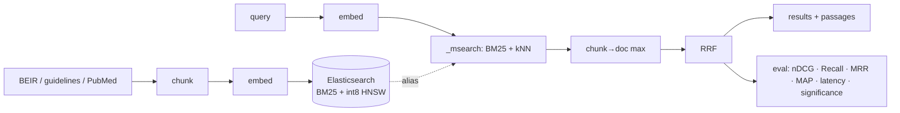

# Clinical Evidence Retrieval

Hybrid retrieval platform for **medical evidence**: offline indexing, lexical + vector search on
Elasticsearch, rank fusion, re-ranking (week 2) and an evaluation framework that makes every design
decision measurable on public biomedical benchmarks.

> Goal: ground clinical AI answers in validated sources (guidelines, studies) with production
> constraints in mind: 100M+ chunks, 50+ req/s, p95 < 300 ms. See **[docs/DESIGN.md](docs/DESIGN.md)**.



## Status

| Milestone | Scope | State |
|---|---|---|
| M1 | Elasticsearch backend, streaming ingestion, BM25 / dense / hybrid (RRF), BEIR evaluation, CI | code + tests, results in progress |
| M2 | Re-ranking (off-the-shelf + fine-tuned cross-encoder, ONNX), FR→EN retrieval | planned |
| M3 | HAS guideline PDFs, query processing, FastAPI with per-stage latency | planned |
| M4 | Write-up: results, capacity model, trade-offs | planned |

See [ROADMAP.md](ROADMAP.md).

## Quickstart

```bash
python -m venv .venv && source .venv/bin/activate
make setup          # pip install -e ".[embed,dev]"   (add ",onnx" for the ONNX re-ranker)
make test           # 25 tests, no Elasticsearch, no model download

make up             # Elasticsearch 8.15 in Docker (single node, security off: local dev only)
make download       # BEIR nfcorpus + scifact into ./data
make ingest         # one versioned index per dataset, alias swapped at the end
make eval           # bm25 / dense / hybrid for each dataset -> runs/<name>/
make report         # reports/results.md
make test-es        # integration tests against the running cluster
```

Other datasets: `make all DATASETS="nfcorpus scifact trec-covid"`. TREC-COVID (~171k documents) is
much faster to embed on a GPU; set `embedder.device: cuda` in its configs.

Single commands:

```bash
cer download scifact
cer ingest configs/scifact_hybrid.yaml            # new index cer-scifact-v1, alias cer-scifact
cer search configs/scifact_hybrid.yaml "does vitamin D prevent fractures"
cer eval configs/scifact_bm25.yaml configs/scifact_hybrid.yaml
cer compare runs/scifact-hybrid/run.trec runs/scifact-bm25/run.trec data/scifact   # permutation test
```

**Windows (PowerShell, Docker Desktop):** `powershell -ExecutionPolicy Bypass -File scripts\run_week1.ps1`
runs the same steps without `make`.

No Docker? `make smoke` runs the whole pipeline in memory (BM25 + hashing vectors) on NFCorpus.

## Results

Generated by `cer report` from `runs/*/metrics.json` (BEIR test splits; numbers produced locally, not copied
from papers). Latency is end to end per query on a laptop CPU (Intel i7-8565U, no GPU), Elasticsearch 8.15
single node in Docker: it includes query embedding on CPU and is not representative of a production tier.

<!-- results:start -->
| run | dataset | ndcg@10 | recall@100 | mrr@10 | map@100 | p50 ms | p95 ms |
|---|---|---|---|---|---|---|---|
| nfcorpus-bm25 | nfcorpus | 0.2958 | 0.2358 | 0.4902 | 0.1336 | 62.2 | 104.5 |
| nfcorpus-dense | nfcorpus | 0.3270 | 0.2797 | 0.5263 | 0.1478 | 129.6 | 145.6 |
| nfcorpus-hybrid | nfcorpus | 0.3528 | 0.3013 | 0.5596 | 0.1629 | 127.3 | 143.4 |
| nfcorpus-hybrid-c2-listwise-scifact-L256-top20 | nfcorpus | 0.3629 | 0.3013 | 0.5861 | 0.1684 | 1804.5 | 1933.8 |
| nfcorpus-hybrid-ms-marco-minilm-l-6-v2-L256-top20 | nfcorpus | 0.3615 | 0.3013 | 0.5877 | 0.1690 | 1262.8 | 1580.4 |
| scifact-bm25 | scifact | 0.6191 | 0.9042 | 0.5832 | 0.5793 | 75.7 | 88.7 |
| scifact-dense | scifact | 0.7035 | 0.9300 | 0.6733 | 0.6657 | 143.0 | 174.3 |
| scifact-hybrid | scifact | 0.7298 | 0.9483 | 0.6970 | 0.6900 | 150.2 | 188.8 |
| scifact-hybrid-c2-listwise-scifact-L256-top20 | scifact | 0.7288 | 0.9483 | 0.6988 | 0.6925 | 1949.3 | 2387.9 |
| scifact-hybrid-ms-marco-minilm-l-6-v2-L256-top20 | scifact | 0.7013 | 0.9483 | 0.6721 | 0.6649 | 1316.4 | 1601.1 |
<!-- results:end -->

Hybrid vs BM25 and dense (paired permutation test, 10,000 permutations, per-query metric):

| dataset | comparison | Δ nDCG@10 | p | Δ Recall@100 | p |
|---|---|---|---|---|---|
| nfcorpus | hybrid vs bm25 | +0.057 | < 0.001 | +0.066 | < 0.001 |
| nfcorpus | hybrid vs dense | +0.026 | < 0.001 | +0.022 | < 0.001 |
| scifact | hybrid vs bm25 | +0.111 | < 0.001 | +0.044 | < 0.001 |
| scifact | hybrid vs dense | +0.026 | 0.050 | +0.018 | 0.105 |

Analysis: [reports/week1.md](reports/week1.md) (baselines), [reports/m2-reranking.md](reports/m2-reranking.md) (re-ranking: an off-the-shelf MS MARCO MiniLM loses on SciFact; a MiniLM fine-tuned listwise on 608 SciFact claims removes that loss, +0.028 nDCG@10 vs the off-the-shelf model, p = 0.002, while no re-ranker beats hybrid RRF significantly).

## What each run produces

```
runs/<name>/
  config.yaml     exact configuration (reproducibility)
  run.trec        TREC run file
  metrics.json    mean metrics, latency p50/p95/p99 per stage, index version and size
  per_query.csv   per-query metrics, latency, and how many top-10 docs came from BM25 only / dense only / both
```

## Design highlights

- **One `_msearch` round trip** for BM25 + kNN, fused client side with RRF after chunk→document max
  aggregation ([ADR-001](docs/adr/001-client-side-rrf.md)).
- **int8 HNSW** vectors, BM25 with English/French analyzers and a `raw` sub-field for codes and acronyms
  ([ADR-002](docs/adr/002-elasticsearch.md)).
- **Versioned indexes behind an alias**: build `vN` offline, evaluate, swap atomically, roll back in one call.
- **Bulk-load mode**: refresh disabled and no replicas during ingestion, restored after.
- **Deterministic chunk ids and citable offsets**: re-ingestion is idempotent, every passage maps back to
  its source span.
- **Evaluation you can trust**: metrics cross-checked against `ranx` in tests, paired permutation test
  between runs, per-stage latency next to quality ([ADR-003](docs/adr/003-evaluation-protocol.md)).
- **Same interface, two backends**: Elasticsearch for real runs, an in-memory backend for tests and CI.

## Layout

```
src/cer/
  schema.py            Document, Chunk, Hit, DocResult
  config.py            YAML experiment config (pydantic)
  data/beir.py         BEIR download + loaders
  ingest/chunking.py   sentence-aware chunking, overlap, offsets, deterministic ids
  ingest/pipeline.py   streaming ingest: chunk -> embed (batched) -> bulk -> finalize -> alias swap
  embed/               sentence-transformers (e5/bge prefixes) + hashing embedder for tests
  index/es.py          Elasticsearch: mappings, versioned indexes, alias swap, _msearch
  index/memory.py      in-process BM25 + exact cosine
  retrieve/            fusion (RRF, max aggregation) + hybrid retriever with timings
  eval/                metrics, runner, significance test
  cli.py               cer download | ingest | search | eval | compare | report
configs/               one YAML per (dataset, mode)
docs/                  DESIGN.md + ADRs
tests/                 unit, end-to-end (memory), integration (Elasticsearch, -m integration)
```

## Data and licences

Datasets are downloaded from their official BEIR location at run time; nothing is redistributed here.
Check each dataset's licence before reuse.
