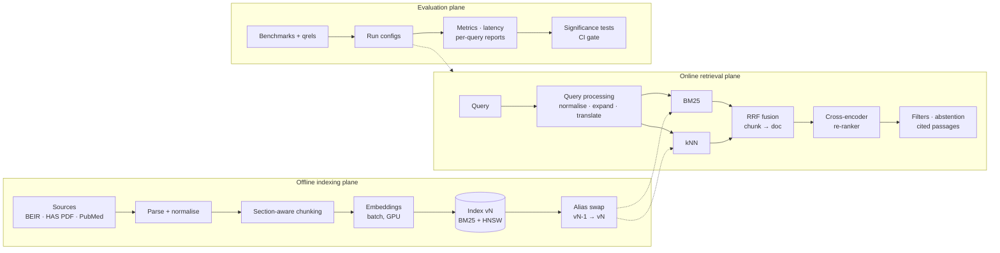

# Clinical Evidence Retrieval — Design document

> Status: v0.1 (M1 implemented) · Owner: Mustapha HAMDI · Last update: 2026-10-16

## 1. Context and goal

Clinical AI assistants (decision support, medical Q&A for health professionals) must ground every
statement in **validated, citable medical sources**: national guidelines (e.g. HAS in France),
learned-society recommendations, peer-reviewed studies. Retrieval is the safety-critical part of
such a system: if the right recommendation is not retrieved, no generator can fix it; if a
low-quality source is retrieved, the generator will cite it confidently.

**Goal of this project:** build, measure and document a retrieval platform for medical evidence that
is designed for production constraints, end to end:

- offline **indexing** pipeline (ingestion, chunking, embeddings, versioned indexes),
- online **retrieval** (query processing, lexical + vector search, fusion, re-ranking),
- an **evaluation framework** that makes every design decision measurable,
- an explicit **latency and capacity** model for 100M+ documents, 50+ req/s, p95 < 300 ms.

### Non-goals (for now)

- Answer generation (LLM). The output of this system is a ranked, filtered list of citable passages.
  Generation is a downstream consumer.
- Clinical validation of content. Source trust is modelled as metadata (source type, evidence grade,
  date), not decided by the system.
- Real patient data. Only public documents and public benchmarks are used.

## 2. Requirements

### Functional

| ID | Requirement |
|---|---|
| F1 | Ingest heterogeneous sources (benchmark corpora as JSONL, guideline PDFs, PubMed records) into one document model |
| F2 | Section-aware chunking; every chunk keeps a pointer to its document, section and position (citation) |
| F3 | Lexical (BM25) and dense (embedding) retrieval over the same chunks |
| F4 | Hybrid fusion of both result lists; document-level results with the best supporting passage |
| F5 | Metadata filters: source type, language, evidence grade, publication date |
| F6 | Query processing: abbreviation and synonym expansion, cross-lingual FR→EN retrieval |
| F7 | Re-ranking of the top candidates with a model trained for the domain |
| F8 | Abstention: return "no reliable evidence" when the best score is below a calibrated threshold |
| F9 | Offline evaluation on public benchmarks with relevance judgments; per-query reports; comparison of runs with significance testing |

### Non-functional (target production envelope)

| ID | Requirement | Target |
|---|---|---|
| N1 | Corpus size | 100M+ chunks |
| N2 | Throughput | ≥ 50 req/s sustained |
| N3 | Latency | p95 < 300 ms end to end (retrieval + re-ranking) |
| N4 | Freshness | new guideline searchable < 24 h after publication |
| N5 | Zero-downtime re-indexing | model or mapping change without serving interruption |
| N6 | Reproducibility | every reported metric reproducible from a config + index version |
| N7 | Traceability | every result carries source, version and passage offsets |

The repository demonstrates these on laptop-scale corpora (10³–10⁶ documents) and documents how they
scale (section 9). Claims at 100M are **capacity estimates**, not measurements.

## 3. Architecture

Three planes share one document model and one configuration.



### Module map (repository)

| Module | Responsibility |
|---|---|
| `cer.schema` | `Document`, `Chunk`, `Hit`, `Query` data model |
| `cer.data.beir` | BEIR loader (corpus, queries, qrels) |
| `cer.ingest.chunking` | section/sentence-aware chunking with overlap and title prefix |
| `cer.ingest.pipeline` | streaming ingestion: chunk → embed in batches → bulk index; idempotent IDs |
| `cer.embed` | embedder interface; sentence-transformers backend (e5 / bge prefixes); hashing embedder for tests |
| `cer.index.es` | Elasticsearch backend: mappings, versioned indexes, alias swap, `_msearch` BM25 + kNN |
| `cer.index.memory` | in-process backend (BM25 + exact cosine) with the same interface, for tests and small experiments |
| `cer.retrieve` | fusion (RRF, weighted RRF), chunk→document aggregation, hybrid retriever with per-stage timings |
| `cer.eval` | metrics (nDCG, Recall, MRR, MAP), experiment runner, run files, paired significance tests |
| `cer.cli` | `cer ingest`, `cer search`, `cer eval`, `cer compare` |

## 4. Data and sources

| Source | Language | Use | Notes |
|---|---|---|---|
| BEIR **NFCorpus** | EN | dev benchmark, medical/nutrition, graded qrels | small, fast iteration |
| BEIR **SciFact** | EN | claim → evidence retrieval | close to "ground a clinical claim" |
| BEIR **TREC-COVID** | EN | larger corpus, biomedical | scale and latency tests |
| HAS recommendations (PDF) | FR | real guideline structure, evidence grades | week 2+; check reuse terms per document |
| PubMed abstracts | EN | scale tests (10⁶+) | via NCBI E-utilities / baseline files |
| French medical queries | FR | cross-lingual evaluation | hand-written + translated BEIR queries, documented |

Licensing and terms of reuse are checked per source before redistribution; the repository ships
**download scripts, not data**.

## 5. Document model and chunking

```
Document(doc_id, title, text, source, lang, url, published, evidence_grade, metadata)
Chunk(chunk_id = sha1(doc_id, index_version_of_chunker, position), doc_id, position,
      section, text, title, lang, source, published, evidence_grade, start_char, end_char)
```

- **Chunk size**: ~200–300 words with ~15 % overlap by default; sentence boundaries respected.
  Short documents (abstracts) stay one chunk.
- **Title prefix**: the title is indexed with each chunk (separate field for BM25, prefixed text for
  embeddings) so a passage stays interpretable out of context.
- **Guidelines (week 2)**: chunk on the document's own structure (section → recommendation), keep the
  grade (A/B/C/AE) as a filterable field, never split a recommendation.
- **Deterministic IDs** make re-ingestion idempotent and let evaluation map chunks back to documents.

## 6. Index design (Elasticsearch)

| Field | Type | Why |
|---|---|---|
| `text`, `title` | `text` (+ language analyzers: `english`, `french`) | BM25 with stemming per language |
| `text.raw` | `text`, standard analyzer | exact-ish matching for codes, drug names, acronyms |
| `embedding` | `dense_vector`, `index: true`, `similarity: cosine`, `index_options.type: int8_hnsw` | ANN search; int8 quantization ≈ 4× less memory than float32 |
| `doc_id`, `source`, `lang`, `evidence_grade` | `keyword` | filters, aggregation |
| `published` | `date` | recency filters and boosts |

- **Versioned indexes behind an alias**: `cer-chunks-v{N}` is built offline, validated by the
  evaluation suite, then the alias `cer-chunks` is swapped atomically. Rollback = swap back.
- **HNSW parameters**: `m = 16`, `ef_construction = 100` by default; `num_candidates` (query-time
  breadth) is the main recall/latency knob and is swept in the evaluation.
- **Hybrid execution**: BM25 and kNN are sent in **one `_msearch` round trip**, fused client side with
  RRF. Client-side fusion is explicit, testable, licence-independent and lets us aggregate chunk→doc
  before fusing. Elasticsearch's native `rrf` retriever is an alternative to benchmark (ADR-001).

## 7. Retrieval pipeline

1. **Query processing** (no LLM on the critical path): Unicode/accents normalisation, medical
   abbreviation expansion (dictionary), synonym expansion from MeSH for BM25 (boosted `should`
   clauses), multilingual embeddings so a French query reaches English evidence.
2. **Candidate generation**: BM25 top-k₁ and kNN top-k₂ chunks (default 100 each).
3. **Chunk → document aggregation**: a document's rank in each list is the rank of its best chunk
   (max), so long documents with many average chunks do not dominate.
4. **Fusion**: RRF `score(d) = Σ_s w_s / (k + rank_s(d))`, `k = 60`, weights default 1.
5. **Re-ranking (week 2)**: cross-encoder on the top 50–100 passages; fine-tuned with hard negatives
   mined from BM25/kNN; exported to ONNX (int8) for CPU/GPU serving.
6. **Post-filters and abstention**: metadata filters, minimum re-ranker score, output = ranked
   documents with the supporting passage and offsets.

## 8. Evaluation methodology

- **Benchmarks**: BEIR test splits with official qrels; metrics computed at document level.
- **Primary metric**: nDCG@10. **Secondary**: Recall@100 (does the right evidence reach the
  re-ranker?), MRR@10, MAP@100.
- **Systems compared**: BM25, dense, hybrid (RRF), hybrid + expansion, hybrid + re-ranker; each
  defined by a YAML config; each run saved in TREC format with its config and index version.
- **Significance**: paired randomization (permutation) test on per-query nDCG@10 between two runs;
  differences are reported with p-values, not just means.
- **Error analysis**: per-query table, worst queries, "found by one retriever only" analysis.
- **Latency**: per-stage timings logged for every query; p50/p95/p99 reported next to quality.
- **Regression gate (CI)**: a small frozen benchmark must not lose more than a set nDCG margin.

## 9. Latency budget and capacity model

### Latency budget (p95, online path)

| Stage | Budget | How |
|---|---|---|
| Query processing | 10–20 ms | dictionaries in memory, cached query embeddings for frequent queries |
| Query embedding | 10–30 ms | small multilingual encoder, ONNX, batched on GPU or CPU |
| BM25 + kNN (`_msearch`) | 60–100 ms | sharded index, `num_candidates` tuned, filters in the query |
| Fusion + aggregation | < 5 ms | in-process |
| Re-ranking | 80–120 ms | cross-encoder, top 50, ONNX int8 / GPU |
| Network + serialisation | 20–30 ms | |
| **Total** | **≈ 200–300 ms** | measured per stage, not guessed (week 3 load tests) |

### Capacity estimate for 100M chunks (to be validated)

- int8 vectors: ≈ 100M × (d + small overhead) bytes → **≈ 40 GB at d = 384, ≈ 80 GB at d = 768**,
  plus the HNSW graph. HNSW search is fast only when vectors are in memory (page cache), so this
  sizes the RAM of the search tier.
- Primary shards sized to ~20–40 GB each; replicas for throughput (50 req/s × fan-out) and HA.
- Levers if the budget is exceeded: smaller embedding dimension (Matryoshka truncation), better
  quantization (int4/BBQ where available), pre-filtering by source/language, tiered indexes (hot
  guidelines vs. long-tail studies), result caching.

## 10. Stack

| Concern | Choice | Alternatives considered |
|---|---|---|
| Language | Python 3.11+ | — |
| Search engine | **Elasticsearch 8.x** (BM25 + HNSW in one engine, filters, aliases) | OpenSearch (same model), Solr (lexical-first), Vertex AI Vector Search (managed ANN, lexical elsewhere), Qdrant/pgvector |
| Embeddings | sentence-transformers; default `intfloat/multilingual-e5-base` (FR/EN) | `BAAI/bge-m3`, domain models (PubMedBERT-based), API models |
| Re-ranker (week 2) | cross-encoder (MiniLM / bge-reranker family) fine-tuned, ONNX Runtime | LLM re-ranking (too slow for 300 ms), ColBERT late interaction |
| Evaluation | own metrics, cross-checked against `ranx` in tests; TREC run files | pytrec_eval, ir_measures |
| Serving (week 3) | FastAPI, async ES client, Prometheus metrics | — |
| Load testing (week 3) | Locust or k6 | — |
| Packaging / CI | `pyproject`, pytest, GitHub Actions with an Elasticsearch service container | — |
| Local infra | docker-compose (single-node ES) | — |

## 11. Roadmap

See [ROADMAP.md](../ROADMAP.md) for details.

| Milestone | Scope | Exit criterion |
|---|---|---|
| **M1** | ES backend, ingestion pipeline, BM25 / dense / hybrid, BEIR evaluation, CI | baseline table on NFCorpus + SciFact, reproducible from configs |
| M2 | re-ranking (off-the-shelf, fine-tuned cross-encoder, ONNX), FR→EN retrieval | re-ranker gain significant on ≥ 1 dataset, or an honest explanation |
| M3 | guideline PDF ingestion (HAS), query processing, FastAPI with per-stage latency | grade filters demo, ablation and latency tables |
| M4 | write-up: results, capacity model, trade-offs, limitations | README + this document final |

## 12. Risks

| Risk | Mitigation |
|---|---|
| Benchmarks ≠ real clinical queries | add a small hand-annotated FR set; report per-dataset, never only averages |
| Laptop scale hides scale effects | measure latency vs. corpus size (10⁴ → 10⁶) and extrapolate explicitly |
| Over-fitting configs to test sets | tune on dev/train splits where available; report test once |
| Licence of guideline content | ship download scripts and parsers, not documents |

## ADRs

- [ADR-001 Client-side RRF over `_msearch`](adr/001-client-side-rrf.md)
- [ADR-002 Elasticsearch as the single retrieval engine](adr/002-elasticsearch.md)
- [ADR-003 Evaluation protocol](adr/003-evaluation-protocol.md)
